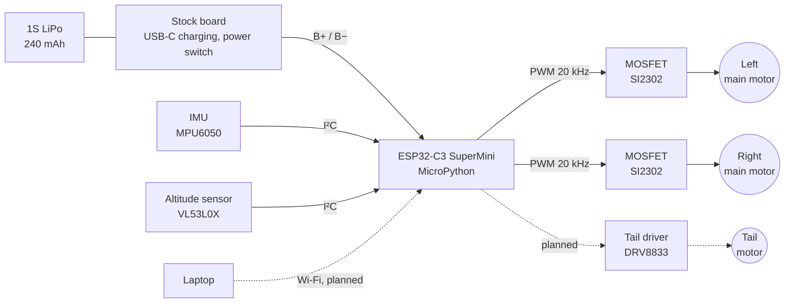
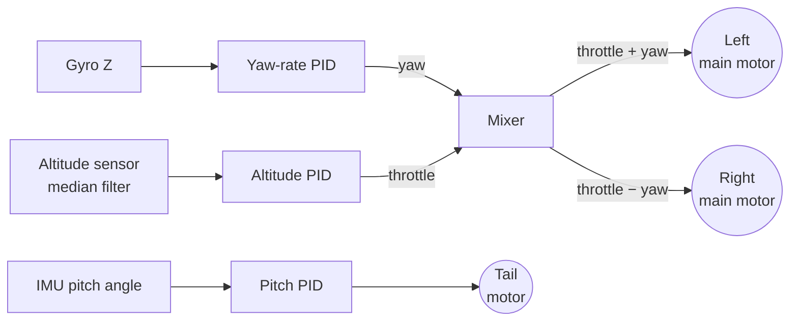

# Custom Flight Controller for a 40 g Coaxial RC Helicopter

The stock flight controller of a €33 toy helicopter (VATOS 2.4G, coaxial) is replaced by a custom one: an ESP32-C3 running MicroPython, an IMU, a laser altitude sensor and PID loops written from scratch.



## Status

- [x] Main motors moved from the stock board to the ESP32, switched by MOSFETs at 20 kHz PWM
- [x] First open-loop lift test
- [x] IMU and altitude sensor wired, IMU calibrated (6-position method, X / Y axes within 0.3%)
- [x] Sensor drivers, filters and the control loop structure (200 Hz target)
- [ ] Vibration test: sensor noise with the motors running
- [ ] Wi-Fi link: arm / disarm, heartbeat failsafe, throttle commands
- [ ] Yaw-rate PID, altitude PID, then pitch PID on the tail motor
- [ ] Tethered hover, then free flight

## The Helicopter

Two counter-rotating main rotors on one shaft, plus a small tail rotor. 1S LiPo, 240 mAh.

| Movement | Controlled by |
|---|---|
| Up / down | Both main motors faster / slower together |
| Turn (yaw) | Speed difference between the two main motors |
| Forward / back (pitch) | Tail motor, blowing up or down |
| Roll | Passive, the flybar keeps it level |

**Weight is the main constraint.** The stock heli weighs 40 g. A lift test with coins taped under it found 53 g as the hard limit, so the target for a controllable hover is 45 g all-up. The new electronics budget is about 7 g: headers removed, no perfboard, MOSFETs soldered dead-bug.

## Hardware

Built point-to-point. The stock board stays for USB-C charging and the power switch; the motors move to the new controller.

| Part | Job |
|---|---|
| ESP32-C3 SuperMini | Flight controller, Wi-Fi |
| IMU (MPU6050, GY-521) | Rotation rates and tilt |
| Altitude sensor (VL53L0X, GY-530) | Height above the floor, laser time-of-flight, facing down |
| 2× MOSFET (SI2302) | One per main motor |
| Tail driver (DRV8833) | Tail motor in both directions (planned) |
| 1N5819 diodes, pull-downs, capacitors | Motor flyback, safe boot, supply filtering |

Design decisions:

- **MOSFETs instead of a motor driver board** for the main motors: about 0.04 V drop instead of 0.3 V. On a 1S battery there is no thrust to spare.
- **DRV8833 for the tail**: reversing a motor needs an H-bridge, and the DRV8833 runs from 2.7 V. The common TB6612 needs 4.5 V.
- **Pull-down on each MOSFET gate**: ESP32 pins float during boot and flashing; without it a rotor can start by itself.
- **Motors on GPIO3–6**: GPIO2 is a boot pin that has to stay high at power-up.
- **ESP32 powered through a diode**: USB and battery can be connected at the same time.

## Control Plan



Order of work: failsafes first (motors off at boot, arm / disarm, Wi-Fi heartbeat, low-battery cutoff), then open-loop throttle to find the hover point, then the yaw-rate PID (without it the heli spins as soon as it lifts), then altitude, then pitch.

## Firmware

MicroPython on the ESP32-C3, in [source/](source/).

| File | Job |
|---|---|
| `main.py` | Control loop: steady dt, sensor reads, filters, motors off unless armed |
| `pid.py` | PID controller |
| `sensors.py` | I²C setup, altitude sensor in continuous mode, IMU calibration and gyro zeroing at every start |
| `mpu6050.py` | IMU driver: calibrated acceleration (g) and rotation rate (°/s) |
| `vl53l0x.py` | Altitude sensor driver, with a read that never waits |
| `filters.py` | Median filter for distance, low-pass for vertical speed |
| `motors.py` | Main motor PWM, clamped to 0–100% |
| `mpu_calibration.py` | 6-position IMU calibration, saved into the config |
| `sensors_test.py` | Vibration test: mean and spread of every reading at a set motor power |
| `settings.py` | Loads `config.json` once |

### Running It

1. Flash MicroPython (`ESP32_GENERIC_C3`).
2. Copy `source/config.example.json` to `source/config.json` and fill in the Wi-Fi settings and pins.
3. Upload from `source/`: `mpremote cp *.py config.json :`
4. Calibrate the IMU once: `mpremote run mpu_calibration.py`
5. Reset the board. `main.py` starts the loop and prints the loop rate every second.

## Repository Layout

```
source/              MicroPython firmware
electric/Kicad_v1/   Schematic (KiCad 9)
electric/assets/     Photos of the stock board
electric/wires.txt   Stock wire colours
```

## Third-Party Code

- `source/vl53l0x.py`: MicroPython port of Adafruit's CircuitPython VL53L0X driver (MIT license), which is based on Pololu's vl53l0x-arduino library.
- The downloaded KiCad libraries are not included. The schematic contains its own copies of the symbols, so it opens without them.
